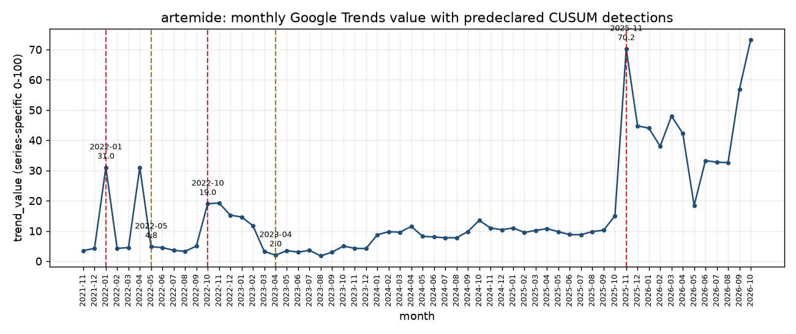
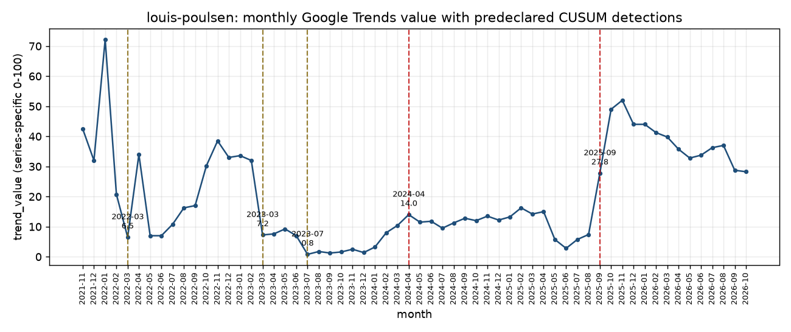
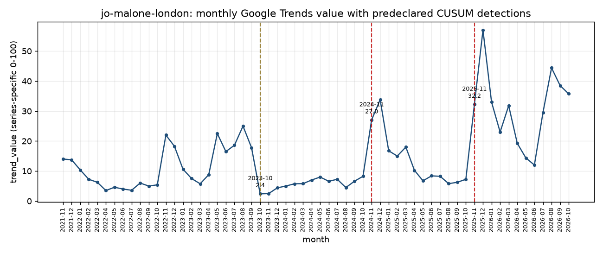

# B extension — Priority 3: descriptive momentum change-point notes

**Optional supplementary analysis.** This is retrospective detection on the already-cleaned Google Trends series. It is **not an ex-ante forecast**, does not change the frozen 90-row holdout, and is not evidence of the cause of any observed spike.

## Predeclared method (fixed before examining results)

- Input: cleaned monthly `trend_value` from `trends_monthly.csv`, excluding the flagged incomplete `2026-11` month.
- Growth: `g_t = log1p(v_t) - log1p(v_(t-1))`; standardised `z_t = g_t / 0.25` with a fixed common scale for all brands (no per-brand fitting).
- Two-sided CUSUM with zero reference: `S+_t = max(0, S+_(t-1) + z_t - 0.5)`, `S-_t = max(0, S-_(t-1) - z_t - 0.5)`, starting at zero.
- Detection when `S+` or `S-` exceeds `h = 5.0`; then both accumulators reset and a 3-month cooldown applies. Identical constants for all 30 brands.

## Results across all 30 brands

- Total detected change points: **24**.
- Brands with at least one detection: **11** of 30.

| slug | detections | months and direction |
|---|---:|---|
| aesop | 1 | 2026-04 (down) |
| anya-hindmarch | 1 | 2023-11 (up) |
| artemide | 5 | 2022-01 (up), 2022-05 (down), 2022-10 (up), 2023-04 (down), 2025-11 (up) |
| assouline | 0 | none |
| astier-de-villatte | 0 | none |
| baccarat | 0 | none |
| bang-olufsen | 0 | none |
| buccellati | 0 | none |
| christofle | 0 | none |
| flos | 0 | none |
| fortnum-mason | 2 | 2022-02 (down), 2023-03 (down) |
| frette | 0 | none |
| herman-miller | 2 | 2026-04 (up), 2026-08 (down) |
| jellycat | 0 | none |
| jo-malone-london | 3 | 2023-10 (down), 2024-11 (up), 2025-11 (up) |
| knoll | 0 | none |
| kodak | 0 | none |
| lego | 0 | none |
| louis-poulsen | 5 | 2022-03 (down), 2023-03 (down), 2023-07 (down), 2024-04 (up), 2025-09 (up) |
| marshall | 0 | none |
| noritake | 0 | none |
| nothing | 2 | 2022-06 (up), 2022-11 (down) |
| oura | 0 | none |
| polaroid | 1 | 2023-03 (down) |
| sennheiser | 0 | none |
| stanley | 1 | 2023-01 (up) |
| teenage-engineering | 0 | none |
| tom-dixon | 0 | none |
| trudon | 1 | 2023-04 (up) |
| vitra | 0 | none |

## Illustrative examples

The three brands below are illustrative charts of the same uniform rule; they are not selected as predictions and are not claimed to be representative of all brands.

### artemide

Detections: 2022-01: up, value 31.0000, accumulator 6.85; 2022-05: down, value 4.8000, accumulator 6.33; 2022-10: up, value 19.0000, accumulator 5.20; 2023-04: down, value 2.0000, accumulator 5.14; 2025-11: up, value 70.2000, accumulator 6.38.



### louis-poulsen

Detections: 2022-03: down, value 6.5000, accumulator 8.11; 2023-03: down, value 7.2500, accumulator 5.05; 2023-07: down, value 0.8000, accumulator 5.96; 2024-04: up, value 14.0000, accumulator 5.33; 2025-09: up, value 27.7500, accumulator 6.59.



### jo-malone-london

Detections: 2023-10: down, value 2.4000, accumulator 7.14; 2024-11: up, value 27.0000, accumulator 5.01; 2025-11: up, value 32.2000, accumulator 5.09.



## Caveats

- Each Google Trends series is independently rescaled to 0–100 over the full extraction window, so later peaks affect earlier values. A retrospective change point can partly reflect that source-side rescaling and one-off Google Trends sampling, not a real-world behavioural shift.
- The fixed scale, drift, threshold and cooldown are descriptive choices, not fitted or optimised for forecast performance. A different threshold would produce different detections; the rule was not tuned on outcomes.
- Seasonal peaks (e.g. holiday months) can trigger the rule. Detections are associations in observed data, not causes and not ex-ante signals.
- The Artemide 2025-11 jump is visible in the source series, but the supplied files contain no event or definition information. **No cause is claimed**; the spike was retained unchanged in all frozen outputs.
- HK data were not available (Google Trends API HTTP 429; see `hk_coverage_report.md`), so this analysis uses the existing provenance-unverified series only.

## Run command

```bash
cd D:\lane-crawford-brand-momentum
python src/trends/momentum_shift_notes.py
```

The script writes only `outputs/trends/momentum_shift_notes.md` and new figures under `outputs/trends/figures/`; no frozen file is modified.
